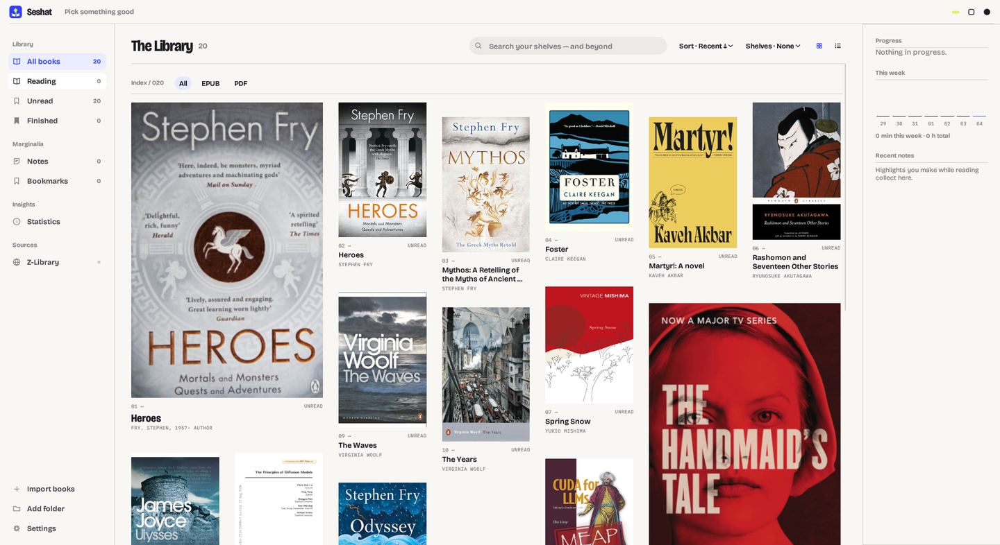
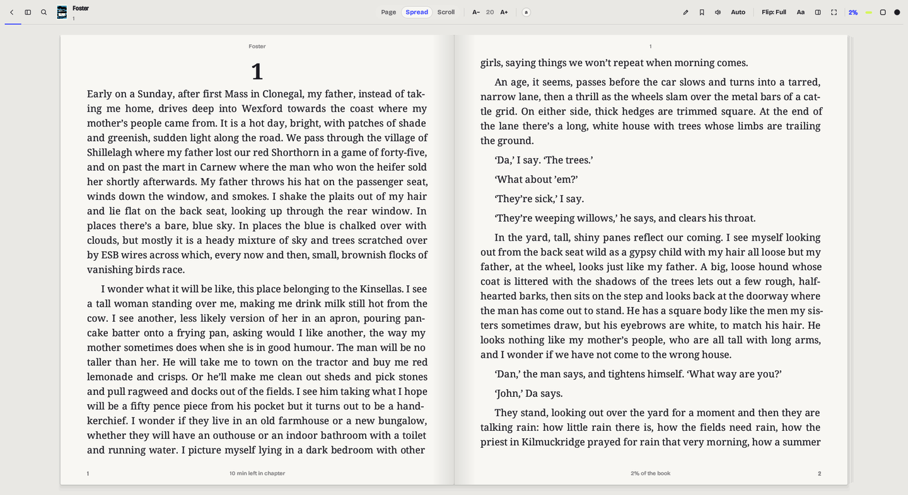
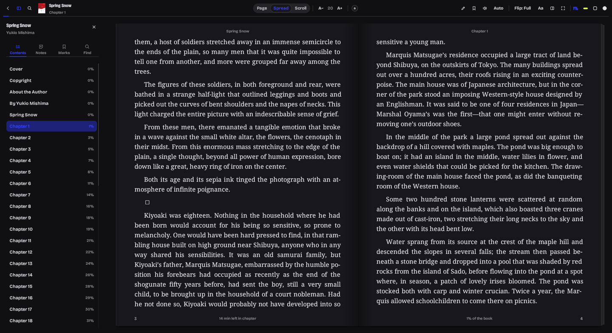
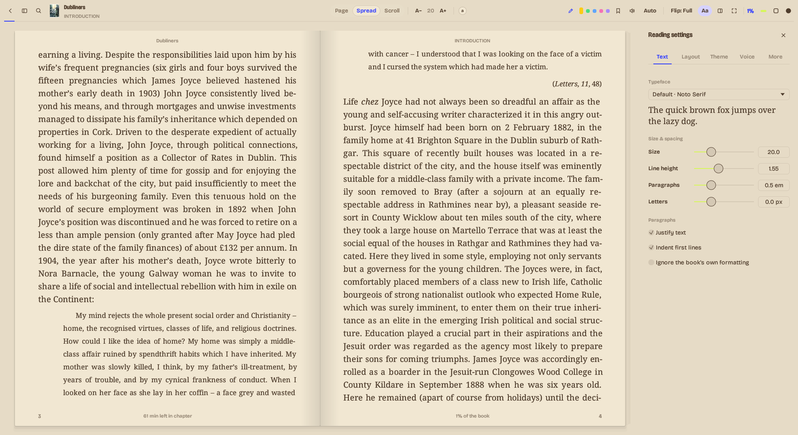

<p align="center">
  
</p>

<h1 align="center">Seshat</h1>

<p align="center">
  A fast, native ebook reader for Linux, Windows and macOS.<br>
  Named after the Egyptian goddess of writing, called the "Mistress of the House of Books".
</p>

<p align="center">
  
</p>

---

Seshat is an ebook reader first. It is built around one idea: opening a book
should feel like opening a book. Your library is a set of shelves rather than
a spreadsheet. Each book opens in its own window as a two-page spread, pages
turn with a real (and optional) paper flip, and everything else stays out of
the way until you reach for it.

It is a single native binary of about 25 MB (an 8 MB download), with no
browser engine and no Electron. It starts in well under a second and turns pages instantly, even in
very long books.

If you also use Z-Library, there is an optional add-on that lets you search for
books and pull them straight onto your shelves. It is off to the side: Seshat
is not a Z-Library client with a reader attached, it is a reader that can talk
to Z-Library if you want it to.

## Screenshots

<p align="center">
  
  <br><em>The library</em>
</p>

<p align="center">
  
  <br><em>A two-page spread</em>
</p>

<p align="center">
  
  <br><em>Dark theme, with the contents sidebar</em>
</p>

<p align="center">
  
  <br><em>Sepia theme, with the reading settings</em>
</p>

## Download

Grab the latest build from the [Releases](../../releases) page.

| Platform | File | Notes |
|---|---|---|
| Windows 10/11 | `Seshat-x.y.z-windows-x64-setup.exe` | Standard installer with Start menu entry and uninstaller |
| Windows (portable) | `Seshat-x.y.z-windows-x64-portable.zip` | Unzip anywhere and run `seshat.exe` |
| macOS 11+ | `Seshat-x.y.z-macos-universal.dmg` | One app for both Apple Silicon and Intel Macs |
| Linux (Debian, Ubuntu, Mint, Pop!_OS) | `Seshat-x.y.z-linux-amd64.deb` | `sudo apt install ./Seshat-*.deb` |
| Linux (any distribution) | `Seshat-x.y.z-linux-x86_64.AppImage` | `chmod +x` it, then run it |
| Linux (manual) | `Seshat-x.y.z-linux-x86_64.tar.gz` | Plain binary with a desktop file and icon |

A note on macOS: the builds are not notarised by Apple yet, so the first time
you open Seshat, right-click the app and choose **Open**. After that it opens
normally.

## What it reads

| Format | Support |
|---|---|
| EPUB 2 and 3 | Full: styles, images, footnotes, table of contents, internal links |
| MOBI, AZW, AZW3 (KF8), PRC | Text, images, metadata and covers. DRM-protected files cannot be opened. |
| FB2 and FB2.ZIP | Full, including embedded images and notes |
| PDF | Rendered natively in pure Rust, with outline, search, zoom and two-page spreads |
| CBZ comics | Fit page or fit width, spreads, and right-to-left order for manga |
| TXT, Markdown, HTML | Chapters are detected automatically |

## Reading

**The page.** Books are laid out by Seshat's own typesetting engine. Text is
justified by adjusting word spacing rather than letter spacing. Headings stay
with the paragraph that follows them. Page breaks always fall between lines,
never through them. A book's own styling (italics, small caps, centred
headings) is respected, and you can override it.

**The spread.** On a wide window the book opens as a two-page spread on a
desk, with a gutter shadow at the spine. The stack of page edges on each side
gets thicker or thinner as you read, so you can see where you are without
looking at a number. Running heads and page numbers are set like a printed
book.

**Motion, if you like it.** The cover swings open when a book opens, and
pages curl over the spine when you turn them. Both are rendered from the real
text, not a canned animation. The Motion setting switches between Full, Simple
(a quick fade) and Off. The first time a book opens, Seshat asks which you
prefer.

**Make it yours.** Seven themes (Paper, Light, Sepia, Gray, Dark, Nord, Black)
plus a custom one. Any font installed on your system, with size, line spacing,
paragraph spacing, letter spacing, margins and maximum line width. Single page,
spread, or continuous scroll.

**Everything a reader needs**

- Contents, notes, bookmarks and full-text search in a sidebar that stays
  closed until you open it
- Highlights in five colours, as a highlight or an underline, with notes
  attached
- A highlighter mode: press `H` and every selection becomes a highlight
  straight away
- A Notebook panel on the right showing the current chapter's highlights and
  notes in reading order, plus quick notes pinned to a page
- Footnotes open in a small popover instead of throwing you to the back of the
  book, and a Back button returns you to where you were
- Look up a word in the dictionary or on Wikipedia, or translate a passage,
  from the selection menu
- Read aloud, following along sentence by sentence, with your system's own
  voices or the optional natural voice (below)
- Auto-advance, which turns pages on a timer or scrolls slowly
- Go to any percentage or page
- Reading time, days read, and a reading-speed estimate that learns from you,
  so "12 min left in chapter" is actually close
- Export your highlights and notes to Markdown

**Natural voice.** For read-aloud that sounds like a person rather than a
robot, Settings → Read aloud offers optional natural voices that run offline
on your CPU, faster than real time on an ordinary laptop:

- English: Kokoro, with 28 voices (US and UK), about a 360 MB download.
- 38 other languages (German, French, Spanish, Russian, Arabic, Hindi,
  Chinese and more): one Piper voice each, about 60–70 MB per language.

Seshat picks the voice by the book's language, and falls back to your system
voice for a language you haven't downloaded. None of this is part of the app:
each voice is downloaded only if you ask for it, checked against a published
checksum, and removed again with one click. Old versions are replaced, never
kept, and speech is generated in memory, so nothing builds up on disk.

**Sync.** Seshat speaks the KOReader sync protocol, so your progress follows
you between Seshat, KOReader and other compatible readers. You can use the
public server or your own.

## The library

- Point Seshat at one or more folders (it picks up `~/Books` automatically) or
  drop files and folders onto the window. New and changed files are indexed in
  the background and nothing is parsed twice.
- Covers are shown at their real proportions in an asymmetric grid, with a
  plain index view if you prefer a list.
- Shelve your books by genre, author, status, format or folder. Each shelf is
  a row you can slide through, a strip at the top jumps to any shelf, and
  "See all" opens a single shelf on its own, so a shelf with 500 books
  doesn't bury the rest.
- A "currently reading" spread, recently opened books, and a right-hand column
  with your progress, the past week of reading and your latest notes.
- Notes and Bookmarks views that gather everything you've marked across every
  book.

## Keyboard

| Key | Action |
|---|---|
| `←` `→`, `Space`, `PgUp` `PgDn` | Previous / next page |
| `Home` `End` | Start / end of chapter |
| `T` | Show or hide the toolbar |
| `C` | Contents sidebar |
| `N` | Notebook |
| `S` | Reading settings |
| `B` | Bookmark this page |
| `H` | Highlighter mode |
| `A` | Auto-advance |
| `Ctrl+K` or `Ctrl+F` | Search in the book |
| `F` or `F11` | Fullscreen |
| `Ctrl +` / `Ctrl −` | Bigger / smaller text |
| `Backspace` | Back to where you were before a jump |
| `Esc` | Close whatever is open, then return to the library |
| `Ctrl+O` | Import books (library) |
| `Ctrl+K` | Focus search (library) |

## The Z-Library add-on

The add-on lives under **Sources** in the sidebar and can be switched off
entirely in Settings.

When it is connected, typing in the library search quietly shows matching
books from Z-Library underneath your own, in a slim row. Click one to see its
details and download it. Downloads land in your library with the catalogue's
cover and metadata attached, which helps with PDFs whose embedded titles are
often useless. For books you already have, "Fetch cover from Z-Library" in a
book's menu does the same retroactively.

"Read online" opens Z-Library's own online reader in your browser. Nothing is
downloaded and it does not use your daily download quota. It is shown only for
books Z-Library offers to read online.

Signing in works with email and password, with session cookies if your account
requires them, or by creating a new account. Seshat looks for a reachable
mirror automatically, and you can set a SOCKS or HTTP proxy (Tor works).

Please use it only with your own account, and respect copyright and the laws
where you live. Seshat is not affiliated with Z-Library.

## Your data

Everything stays on your machine unless you turn on sync or use a lookup.

| What | Where |
|---|---|
| Settings, library index, progress, highlights | `~/.config/seshat` (Linux), `~/Library/Application Support/seshat` (macOS), `%APPDATA%\seshat` (Windows) |
| Cover thumbnails | your OS cache directory, under `seshat` (thumbnails of books no longer in your library are cleared after each scan) |
| Natural voice, if installed | `~/.local/share/seshat/voice` (Linux), `~/Library/Application Support/seshat/voice` (macOS), `%LOCALAPPDATA%\seshat\voice` (Windows) |

Book files are never modified. The dictionary, Wikipedia and translation
lookups send the selected text to those services only when you ask for a
lookup.

## Building from source

You need a recent stable Rust toolchain.

```sh
git clone https://github.com/StarAtNyte/seshat
cd seshat
cargo run --release
```

On Linux you also need the usual GUI development packages:

```sh
sudo apt install libgtk-3-dev libxkbcommon-dev libwayland-dev
```

`seshat --info book.epub` prints what Seshat makes of a book (title, author,
sections and timing), which is handy when a file misbehaves.
`seshat --say book.epub [seconds]` reads a book aloud with your chosen voice
and prints each sentence as it is spoken.
`seshat --make-icons dir/` regenerates the icon set from the vector logo.

The natural-voice helper lives in `voice/` and builds separately, so a plain
`cargo build` never pulls in its speech engine:

```sh
sudo apt install libasound2-dev     # Linux only, for audio output
cargo build --release -p seshat-voice
```

A `seshat-voice` binary next to `seshat` (or one named by `$SESHAT_VOICE`) is
used instead of the downloaded one, which is handy during development.

Releases are built by GitHub Actions: pushing a tag such as `v0.3.0` produces
every package listed above.

## How it is put together

| Module | What it does |
|---|---|
| `book/` | Format parsers (EPUB, MOBI/KF8, FB2, PDF, CBZ, TXT/HTML), a forgiving HTML tokenizer and a small CSS subset, all converted into one document model |
| `reader/layout.rs` | The typesetting engine: blocks to lines to pages, word-space justification, hit testing for selection |
| `reader/` | The reading window: the spread, motion, chrome, sidebars, search, highlights, read-aloud |
| `library.rs` | Parallel, incremental indexing with cached metadata and covers |
| `online.rs`, `api.rs` | The Z-Library add-on |
| `tts.rs`, `voice.rs` | Read-aloud: system voices, and installing and driving the natural voice |
| `voice/` | `seshat-voice`, the optional natural-voice helper (Kokoro and Piper via sherpa-onnx), shipped as a separate download |
| `kosync.rs` | KOReader-compatible progress sync |
| `logo.rs` | The Seshat mark, drawn live in the app and rasterised for the icons |

## Credits

Built with [egui](https://github.com/emilk/egui). PDFs are rendered by
[hayro](https://github.com/LaurenzV/hayro). The natural voices are
[Kokoro](https://huggingface.co/hexgrad/Kokoro-82M) (Apache-2.0) and
[Piper](https://github.com/rhasspy/piper) voices (licences per voice, listed in
each download's MODEL_CARD), run by [sherpa-onnx](https://github.com/k2-fsa/sherpa-onnx). The interface is set in
[Bricolage Grotesque](https://github.com/ateliertriay/bricolage) and
IBM Plex Mono, both under the SIL Open Font License (see `assets/fonts`).
Feature inspiration comes from [Readest](https://github.com/readest/readest)
and KOReader.

## License

MIT
